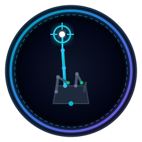
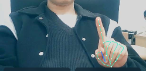

<div align="center">

  

  # 🖐️ ManuX: Next-Gen AI Vision Air Mouse

  **웹캠과 온디바이스 MediaPipe AI 비전으로 모니터 위에 투명 AR HUD를 띄워 손으로 Windows를 제어하는 차세대 핸즈프리 에어 마우스 시스템**

  <p align="center">
    
    
    
    
    
  </p>
  <p align="center">
    
    
    
    
    
  </p>

</div>

---

<div align="center">
  
  <p><em>▲ 실제 웹캠 환경에서 검지 포인터(LM 8) 및 손 관절 랜드마크가 정밀 추적되는 기본 조작 자세</em></p>
</div>

---

## ⚡ 빠른 실행 (1-Click Run)

`manux` 폴더의 **`실행.bat`**를 더블클릭하면 의존성 검사, 오프라인 인식 모델 다운로드, 앱 실행이 자동으로 처리됩니다.

```batch
실행.bat
```

> **시스템 요구사항**: Windows 10/11 (x64), Node.js (LTS), 일반 USB 웹캠 또는 노트북 내장 카메라

---

## 🚀 새로운 상호작용 패러다임 (Core Paradigm)

기존 웹캠 에어 마우스의 한계(미세 떨림, 클릭 시 커서 쏠림, 시선 분산, 어색한 자세 피로)를 해결하기 위해 **5가지 혁신적인 인터랙션 아키텍처**를 적용했습니다.

### 1. 모니터 투명 HUD 오버레이 (아이 트래커 방식)
* 작은 웹캠 창을 답답하게 쳐다볼 필요가 없습니다. 웹캠 영상은 백그라운드에서 투명 처리되며, **모니터 화면 전체에 검지(LM 8)·엄지(LM 4)·중지(LM 12) 네온 AR 포인트가 직접 오버레이**됩니다.
* Electron의 `setIgnoreMouseEvents(true, { forward: true })` 기술로 웹서핑, 문서 편집, 게임 등 모든 Windows 프로그램 위에서 투명하게 클릭이 관통됩니다.

### 2. 검지 포인터 1:1 절대 추적 & $1€$ 손떨림 방지 필터
* **제스처 제약 없는 자유로운 이동**: 특정 제스처(제스처 1)에 얽매이지 않고, **주먹(휴식) 상태가 아닌 모든 자세에서 검지 끝(`LM 8`)을 항상 마우스 커서로 직접 추적**합니다.
* **$1€$ 필터 (One Euro Filter) + 정지 데드존(2.5px)**:
  * 마우스를 멈추거나 아이콘/버튼 위에 올려둘 때는 미세 떨림 감쇠 필터가 강력하게 작동하여 커서가 단 1픽셀도 흔들리지 않고 고정됩니다.
  * 손을 빠르게 움직일 때는 필터가 즉각 반응하여 지연(Lag) 없이 화면 전체를 시원하게 활주합니다.
* **1:1 절대 좌표 매핑 (`0x8001`)**:
  * 투명 HUD의 청록색 조준점 중심과 실제 Windows 마우스 커서가 단 1픽셀의 오차도 없이 동일한 위치에 놓입니다.
* **사각지대 소멸 & 화면 이탈 방지**:
  * 손이 가장 편안하게 움직일 수 있는 **중앙 안전 구역($X: [0.28, 0.72]$, $Y: [0.20, 0.68]$)을 모니터 100% 전체 화면으로 1:1 매핑**하여 팔을 크게 휘젓지 않아도 모니터 구석구석 도달합니다.

### 3. 엄지 + 중지: 좌클릭, 더블클릭 & 100% 신뢰성 연속 드래그
* **검지 조준 분리 (Click-Dip 0%)**: 검지는 오직 포인터 조준만 담당하고, 좌클릭은 **엄지(`LM 4`)와 중지(`LM 12`)**가 맞닿는 동작으로 수행하여 클릭 순간 커서가 흔들리지 않습니다.
* **즉각 반응 더블클릭**: 핀치 감지 딜레이를 완전히 제거하여, 검지로 조준한 채 **엄지와 중지를 톡톡 2번 맞대면 Windows 네이티브 더블클릭이 즉시 실행**됩니다.
* **16px Click-Freeze Lock**: 클릭 진입 순간 커서를 일시 고정하여 더블클릭 도중 드래그로 빗나가는 현상을 원천 방지합니다.
* **연속 드래그**: 엄지와 중지를 맞댄 채로 손을 움직이면 창 이동, 파일 드래그앤드롭, 텍스트 블록 지정이 끊김 없이 유지되며, 손가락을 떼는 순간 즉시 해제됩니다.

### 4. 엄지 + 약지: 우클릭 & 완전한 좌/우 독립성 (동시 클릭 지원)
* **동작**: **엄지(`LM 4`)와 약지(`LM 16`)가 맞닿으면 우클릭**이 발동됩니다.
* **V자 스크롤과의 완벽 분리**: V자(✌️) 제스처를 취할 때 약지가 자연스럽게 굽혀지더라도, V자 스크롤 제스처가 우선 판정되므로 원치 않는 우클릭이 발생하는 일이 전혀 없습니다.
* **완전한 상호 독립성 & 동시 클릭**:
  * 좌클릭(엄지+중지)과 우클릭(엄지+약지) 판정은 서로 간섭하지 않는 완전 독립 구조입니다.
  * 엄지에 **중지와 약지를 둘 다 맞대면 좌클릭과 우클릭이 동시에 눌린 상태(`both`)**가 정상 구현됩니다.
* **주먹(Fist) 상태 오클릭 100% 차단**: 주먹을 쥐었을 때는 모든 클릭 판정을 원천 무효화하여, 주먹을 쥐면서 손가락들이 뭉쳐도 가짜 클릭이 일체 발생하지 않습니다.

### 5. 제스처 2: 스마트폰 터치 & 손 떼기 스크롤 (Peace Sign)
* **스마트폰 터치 동기화**: 검지와 중지를 펴서 V자(Peace sign)를 만들면 두 손가락 끝의 중점을 기준으로 가상 터치 앵커가 생성됩니다.
* **위로 튕기면 아래로 스크롤**: 스마트폰 화면을 손가락으로 튕기듯, **두 손가락을 위로 그으면 화면이 아래로 스크롤**됩니다.
* **주먹 쥐어 손 떼기 (역스크롤 0%)**: 스크롤을 더 내리고 싶을 때 주먹을 살짝 쥐면 화면에서 손을 뗀 상태가 되어, 손을 아래로 원위치시켜도 반대 방향 스크롤이 전혀 발생하지 않습니다. 다시 V자를 펴서 위로 튕기면 연속 스크롤이 이어집니다.
* **스크롤 중 클릭 100% 차단**: V자 제스처 중에는 마우스 이동과 좌/우클릭이 강제 억제되어 오동작이 없습니다.

---

## 🎮 제스처 조작 표 (Gesture Cheatsheet)

| 제스처 | HUD 시각 피드백 | 기능 | 상세 동작 및 생체역학 |
| :---: | :---: | :---: | :--- |
| **👆 검지 단독 포인팅** | 청록색(Cyan) 조준링 & 십자선 | **커서 절대 이동** | 주먹 외 모든 상태에서 검지 끝(LM 8) 1:1 절대 매핑 ($1€$ 떨림 방지) |
| **🤏 엄지 + 중지 핀치** | 에메랄드(Emerald) 레이저 선 | **좌클릭 · 더블클릭 · 드래그** | 즉각 반응 더블클릭, 유지 시 연속 드래그 (Click-Dip 0%) |
| **👌 엄지 + 약지 핀치** | 파란색(Blue) 레이저 선 | **우클릭** | 엄지와 약지 접촉 시 즉각 우클릭 (좌우 독립 판정, 동시 클릭 지원) |
| **✌️ 제스처 2 (V자)** | 보라색(Purple) 트윈 가이드 | **스마트폰 터치 스크롤** | V자 편 채 위로 튕기면 아래 스크롤, 주먹 쥐어 원위치 복귀 |
| **✊ 주먹 (Fist)** | 회색(Dimmed) 비활성 링 | **클러치 휴식 (Rest)** | 주먹을 쥐면 모든 추적 및 입력 즉시 정지 (완전한 휴식 모드) |

---

## ⌨️ 단축키 안내 (Keyboard Shortcuts & Hotkeys)

| 단축키 | 적용 범위 | 설명 |
| :--- | :--- | :--- |
| **`F11`** | 앱 창 및 오버레이 | **화면 투명 HUD 오버레이 모드 토글** (모니터 전체 화면 AR 모드) |
| **`Esc`** | 앱 및 오버레이 | **일반 창 모드로 복귀** / 제어 일시 중지 |
| **`Ctrl + Alt + M`** | **Windows 전체 (글로벌)** | **비상 제어 중지 (Emergency Stop)** (어떤 프로그램 실행 중에도 즉시 마우스 권한 해제) |

---

## 🛠️ 시스템 아키텍처 (System Architecture)

```
[ 웹캠 비디오 입력 (60fps) ]
            │
            ▼
[ MediaPipe Tasks Vision (v1.2.0) ] ── 21개 3D 핸드 랜드마크 고속 추출
            │
            ▼
[ AirMouseController ]
  ├─ 1€ Filter (One Euro) & 2.5px Deadband ── 손떨림 원천 억제
  ├─ 1:1 Absolute Mapping (X:[0.28,0.72], Y:[0.20,0.68]) ── 사각지대 해소
  ├─ Independent Pinch State Machine (Middle: Left / Ring: Right)
  └─ Smartphone Touch Inertial Scroll (Peace Sign V-Gesture)
            │
      ┌─────┴────────────────────────┐
      ▼                              ▼
[ HTML5 Canvas AR HUD ]       [ Electron IPC Bridge ]
- 투명 오버레이 레이어         - safe IPC token lease & watchdog
- 실시간 21개 관절 스켈레톤   - Win32 SendInput (C# P/Invoke)
- 관절별 네온 상태 피드백      - 0x8001 Absolute Move / Click / Wheel
```

---

## 🧬 기술 스택 (Tech Stack)

### 1. Vision & AI Engine
* **Google `@mediapipe/tasks-vision` (v1.2.0)**: 온디바이스 Hand Landmark Recognizer (21개 3D 랜드마크를 실시간 추론)
* **Biomechanical Normalization**: 손목(`LM 0`) ~ 중지 뿌리(`LM 9`) 유클리드 거리를 기준으로 핀치 임계값을 동적 정규화하여 카메라와의 거리에 무관한 균일한 감도 보장

### 2. Motion & Ergonomics Filtering
* **One Euro Filter ($1€$ Filter)**: 저속 정지 시 커트오프 주파수($f_c = 0.25\text{Hz}$)로 미세 떨림 차단, 고속 이동 시 적응형 파라미터($\beta = 9.0$)로 지연 시간 0ms 달성
* **Stationary Tremor Deadband**: 2.5px 이내의 미세 센서 노이즈 무시
* **16px Click-Freeze Lock**: 핀치 체결 직후 16px 이내 커서 잠금으로 더블클릭 시 빗나감 방지

### 3. Desktop Shell & Transparent Overlay
* **Electron (v45.2.1 / Chromium / Node.js v24)**: 투명 프레임리스 윈도우 (`transparent: true`, `backgroundColor: '#00000000'`)
* **OS-Level Click-Through**: `win.setIgnoreMouseEvents(true, { forward: true })`를 통한 투명 AR 오버레이 구현

### 4. Native Windows Input Driver
* **Windows PowerShell + C# Inline P/Invoke**:
  * Win32 `SendInput` API (`MOUSEEVENTF_ABSOLUTE | MOUSEEVENTF_MOVE = 0x8001`, `0..65535` 좌표계)
  * 비정상 종료 시 자동 릴리즈되는 Process Watchdog 및 임대 만료(Lease Expiry) 안전 메커니즘 탑재

---

## 🧪 테스트 및 품질 검증

본 프로젝트는 안전한 입력 제어와 제스처 무결성을 위해 43개의 자동화 테스트 및 Windows SendInput 드라이버 드라이런 검증을 내장하고 있습니다.

```powershell
# 단위 테스트 (AirMouseController, Desktop IPC, 제스처 상태 기계 43개 전원 통과)
npm test

# Windows 네이티브 SendInput 드라이버 안전성 검증 (dry-run 모드로 실제 커서 간섭 없이 검증)
npm run test:native
```

---

## 🔒 개인정보 및 보안 원칙

* **100% 로컬 오프라인 처리**: 웹캠 영상과 손 관절 좌표는 외부 서버로 전송되지 않으며 사용자 PC 메모리 내에서만 실시간 처리 후 소멸됩니다.
* **비상 정지 보장**: `Ctrl + Alt + M` 글로벌 단축키는 언제든 즉시 시스템 제어권을 회수하며, 앱 비정상 종료 시 네이티브 드라이버가 누른 상태의 모든 마우스 버튼을 즉각 릴리즈합니다.
