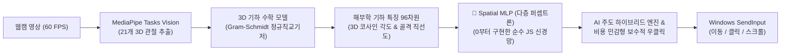

<div align="center">

  

  # 🖐️ ManuX: Next-Gen AI Vision Air Mouse

  **웹캠과 온디바이스 MediaPipe 비전 + 자체 제작 초경량 공간 신경망(SpatialPoseModel)으로 모니터 위에 투명 AR HUD를 띄워 손으로 Windows를 제어하는 차세대 핸즈프리 에어 마우스 시스템**

  <p align="center">
    
    
    
    
    
    
  </p>
  <p align="center">
    
    
    
    
    
    
  </p>

</div>

---

## ⚡ 빠른 실행 (1-Click Run)

`manux` 폴더의 **`실행.bat`**를 더블클릭하면 의존성 검사, 오프라인 인식 모델 다운로드, 앱 실행이 자동으로 처리됩니다.

```batch
실행.bat
```

> **시스템 요구사항**: Windows 10/11 (x64), Node.js (LTS), 일반 USB 웹캠 또는 노트북 내장 카메라

---

## 🤖 자체 제작 온디바이스 AI 모델: SpatialPoseModel (Spatial MLP)

ManuX는 단순 휴리스틱 기하 공식의 사각지대(카메라 앵글, 손목 회전, 손가락 굵기 편차 등)를 극복하기 위해 **엄밀한 3D 기하 수학 모델 위에 자체 개발 초경량 다층 퍼셉트론(Spatial MLP)을 결합한 하이브리드 공간 신경망**을 탑재했습니다.



### 1. 수학적 기하 모델 위에 AI를 얹은 하이브리드 아키텍처
> **💡 왜 단순 관절 좌표를 쓰지 않는가?**  
> MediaPipe가 제공하는 21개 관절의 단순 $(x, y, z)$ 픽셀 좌표를 그대로 신경망에 집어넣으면, **카메라와의 거리, 손목의 회전 각도(Roll/Pitch/Yaw), 손 크기 편차**에 따라 좌표가 제각각으로 변해 모델이 쉽게 무너집니다.  
> 따라서 신경망에 들어가기 전, 철저한 3D 기하학 수학 계산을 거쳐 회전 및 거리 불변성을 확보한 **96차원의 정규화 기하 벡터**를 추출하여 AI의 입력으로 사용합니다.

* **3D 그람-슈미트(Gram-Schmidt) 직교 기저 기반 모델링**:
  손목(0번)과 중지 관절(9번)을 잇는 축을 기준 삼아 **손바닥 고유의 3차원 정규직교기저($\hat{u}, \hat{v}$)**를 수학적으로 유도합니다. 손목이 돌아가거나 카메라 각도가 틀어져도 손바닥 기준 로컬 평면으로 좌표를 사전에 투영·정규화하므로 완벽한 회전 불변성을 가집니다.
* **96차원 해부학 기하 특징(Domain Feature Engineering)**:
  5대 손가락 3D 관절 코사인 각도(`cos3D`), 소지 3마디 골격 직선도 비율(`StraightRatio`), 핵심 관절 간 3D 클리어런스 등 엄밀한 기하학적 계산치 96차원을 AI의 입력값으로 활용합니다.

### 2. 0부터(From Scratch) 직접 구현한 다층 퍼셉트론(MLP) & 역전파(Backpropagation)
* **프레임워크 프리 (Zero-Dependency & Zero-GC)**:
  TensorFlow, PyTorch 같은 외부 라이브러리나 남이 만든 사전 학습 체크포인트를 일절 쓰지 않고, 순수 JavaScript로 밑바닥(From Scratch)에서 100% 직접 구현했습니다.
* **수학적 학습 파이프라인 자체 구현**:
  He 가중치 정규 초기화, LeakyReLU 활성화 함수, 미적분 연쇄법칙 기반의 **오차 역전파(Backpropagation)**, 1·2차 모멘텀을 적용한 **Adam 옵티마이저**를 바닥부터 코딩하여 학습을 수행했습니다.
* **TCN(Temporal Convolutional Network)과의 차별점 (Spatial MLP)**:
  과거 수십 프레임의 시계열 버퍼링이 필요하여 인풋 랙(Input Lag)을 유발하는 TCN과 달리, 1프레임 즉각 공간 기하를 판정하는 **Spatial MLP**를 채택하여 **인풋 랙 0초(Zero-Lag, 0.003ms)**를 달성했습니다. 시간적 떨림 방지와 채터링 방어선은 제어기의 상태머신이 전담하여 속도와 통제력을 동시에 확보했습니다.

### 3. 신경망 세부 구조 (Architecture)
* **입력층 (96 Features)**: 3D 관절 상대 좌표(63) + 손가락-손목 거리비(5) + 관절 간격(8) + 3D 각도 코사인/기저 투영/직선도(20)
* **은닉층**: 64 Hidden Units (LeakyReLU, L2 정규화 및 비용 민감형 비대칭 손실 적용)
* **출력층**: 6개 액션 클래스 Softmax 확률 분포 + AI 주도 보수적 결정 경계 (`move`, `left_click`, `right_click`, `both_click`, `scroll`, `idle`)

### 4. 지속적 학습(Continual Learning) 및 검증 지표
사용자가 `Pose Snapshot Studio`로 수집한 **총 12,150개 실제 손 관절 데이터셋(17개 파일)**을 점진 학습(Continual Training)했습니다.

| 검증 지표 | 달성 수치 | 의미 및 기술적 성과 |
| :--- | :---: | :--- |
| **누적 학습 데이터셋** | **12,150개 표본** | 골드 기준 데이터 + 2~10차 취약 각도/채터링/휴식 코너케이스 전수 수집 (17개 파일) |
| **5-Fold 교차 검증** | **96.07%** | 5개 Fold 전 구간(94.40%~97.20%) 균일 성능으로 과적합 완전 배제 |
| **홀드아웃 테스트 정확도** | **97.16%** | 2,430개 독립 테스트셋 검증 (이동/스크롤/아이들/클릭 전 영역 고른 정확도) |
| **10차 최종 idle 보정 데이터셋 개선율** | **61.18% ➔ 100.00%** | 손 쉴 때 마우스 이동으로 튀던 현상(125건) ➔ **0건 (100% 완전 해결, 322/322 일치, SYS 100%)** |
| **단일 프레임 추론 속도** | **0.0033 ms** | 초당 30만 프레임 이상 연산 가능한 초경량 온디바이스 엔진 |

---

## 🛡️ 무결점 채터링 방지, 연속 스크롤 유지 및 AI 주도 보수적 우클릭

에어 마우스 환경에서 발생할 수 있는 **미세 떨림(채터링)**, **스크롤 끊김**, **우클릭 오작동**, **드래그 중 풀림 및 더블클릭 씹힘**을 완벽히 해결하기 위해 정밀 제어 아키텍처를 적용했습니다:

1. **연속 V-Sign 스크롤 홀드 유지 (Zero Oscillation)**:
   - V-Sign 스크롤 진입 시 릴리즈 카운터를 매 프레임 초기화하고, 약지(Ring) 굽힘 판정의 히스테리시스 역전 현상을 제거하여 수초 이상 연속 스크롤 시에도 0.5초 단위 끊김 없이 완벽하게 유지됩니다.
   - 스크롤 중 일시적 카메라 프레임 드랍(< 300ms)이 발생하더라도 스크롤 앵커와 홀드 상태를 그대로 보존합니다.
2. **AI 주도 보수적 우클릭 & 안티 채터링 (Anti-Chattering Right-Click)**:
   - **우클릭 릴리즈 방어선**: 우클릭 홀드 중 경계선 흔들림이 발생해도 새끼손가락이 확실히 주먹 안으로 접히지 않는 한(`pkVsRing > 1.00`, `dPinkyRingTip > 0.12`), **4프레임(~133ms) 릴리즈 방어선**을 유지하여 우클릭이 0.1초 단위로 풀렸다 닫히는 채터링(바운싱)을 원천 차단했습니다.
   - **이동 모드 우클릭 오작동 0건 달성**: 우클릭 채터링 코너케이스 표본(547개)을 AI에 추가 학습시켜, 이동(`move`) 중 새끼손가락이 살짝 들릴 때 우클릭으로 오분류되던 159건의 채터링을 **0건(100% 제거)**으로 해결했습니다.
3. **드래그 끊김 방지 vs 고속 더블클릭 보존 (Drag Continuity & Double-Click Preservation)**:
   - **고속 더블클릭 보존**: 고신뢰도(`>= 0.72`) 프레임에 대해 AI 롤링 버퍼 지연을 바이패스(Zero-Lag Fast-Path)하여, 빠른 `딸깍-딸깍` 더블클릭 시 릴리즈 및 재진입 프레임이 채터링으로 오인되어 씹히는 현상을 원천 방지합니다.
   - **드래그 중 끊김 방지**: 드래그 잠금이 해제(`dragUnlocked`)된 연속 드래그 상태에서는 엄지가 완전히 접히지 않는 한 경계선 흔들림에 대해 **4프레임(~133ms) 릴리즈 방어선**을 적용하여 드래그 도중 1~3프레임 인식이 흔들려도 드래그가 절대 풀리지 않습니다.
4. **스크롤-클릭 100% 상호 배타성 & 탈출 쿨다운**:
   - 스크롤과 클릭은 동시에 발생할 수 없으며, 스크롤 종료 직후 **4프레임(~130ms) 쿨다운** 동안 손가락 복귀 시 발생하는 근육 연동 트위치를 100% 차단합니다.

---

## 📂 프로젝트 폴더 구조 및 핵심 파일 안내

```text
manux/
├── 📄 package.json                  # 프로젝트 메타데이터, 의존성 및 테스트 스크립트
├── 📄 server.js                    # 로컬 정적 서빙 및 개발 서버
├── 📄 실행.bat                     # 원클릭 환경 구성 및 앱 실행 스크립트
├── 📄 README.md                    # 프로젝트 종합 안내 문서
├── 📄 TROUBLESHOOTING.md           # 12개 기술 트러블슈팅 및 데이터 분석 상세 로그
│
├── 🧠 src/                          # [핵심] 웹캠 비전, 제스처 판정 및 AI 엔진
│   ├── ⭐ air-mouse-controller.js   # 🔥 [핵심 1: 하이브리드 제어기] 3D 정규직교기저 + AI 판정 융합 + 상호배타/안티채터링 상태머신
│   ├── ⭐ spatial-pose-model.js     # 🔥 [핵심 2: 공간 자세 AI 모델] 12,150개 표본 기반 순수 JS 초경량 신경망 (0.003ms 추론)
│   ├── 📁 recorder/                 # [데이터 수집 & 검증 엔진]
│   │   ├── ⭐ pose-snapshot-studio.js # [자세 표본 스튜디오] 단일/연속 표본 수집, 시스템 판정 vs 정답 대조, 취약 각도 검출
│   │   └── 📄 raw-temporal-recorder.js # 시계열 원본 연속 프레임 및 라벨 어노테이션 수집 엔진
│   ├── 📄 mouse-workspace.js        # UI 상호작용, Active Zone 드래그/리사이즈, Studio 및 오버레이 상태 동기화
│   ├── 📄 app.js                    # 웹캠 비디오 스트림 제어, 60fps 비전 루프, 캔버스 스켈레톤 렌더링
│   ├── 📄 camera.js                 # 웹캠 해상도(480p/720p/1080p) 및 디바이스 스트림 제약 조건
│   ├── 📄 vision-client.js          # MediaPipe Tasks Vision 클라이언트 인터페이스
│   └── 📄 vision-worker.js          # 백그라운드 웹 워커 (메인 UI 프레임 드랍 없는 비전 추론)
│
├── 🖥️ desktop/                      # Electron 데스크톱 셸 및 Windows 네이티브 드라이버
│   ├── 📄 main.mjs                  # Electron 메인 프로세스 (투명 프레임리스 윈도우, 마우스 이벤트 관통)
│   ├── 📄 preload.cjs               # 렌더러와 OS 간의 격리된 보안 IPC 브리지
│   ├── 📄 mouse-bridge.mjs          # Node.js ↔ PowerShell 네이티브 드라이버 IPC 생명주기 관리
│   ├── 📄 security.mjs              # 안전한 IPC 원격 호출 검증 및 토큰 유효성 검사
│   └── 📄 windows-mouse.ps1         # Windows C# P/Invoke Win32 SendInput (0x8001 절대 좌표) 네이티브 드라이버
│
├── 🌐 public/                       # 프론트엔드 UI 자산
│   ├── 📄 index.html                # 설정 대시보드, Pose Snapshot Studio 및 화면 전체 투명 AR HUD 오버레이
│   ├── 📄 styles.css                # 반응형 레이아웃, 슬라이드 스위치, 비교 뱃지, Active Zone 스타일
│   ├── 📁 assets/                   # SVG 로고 및 그래픽 리소스
│   └── 📁 models/                   # MediaPipe Tasks Vision 오프라인 모델 (`gesture_recognizer.task`)
│
├── 🧪 tests/                        # 자동화 테스트 스위트 (100% 로컬 검증, 총 95개 테스트)
│   ├── 📄 air-mouse-controller.test.js # 관절 기하학, 3D 기저, 제스처 상태머신, 연속 스크롤, 보수적 우클릭, 드래그/더블클릭 (51개 테스트)
│   ├── 📄 spatial-pose-model.test.js    # 공간 자세 AI 모델 정확도, 메타데이터, 초저지연 검증 (5개 테스트)
│   ├── 📄 desktop-mouse.test.js     # 데스크톱 IPC 및 SendInput 드라이버 안전성 (9개 테스트)
│   ├── 📄 raw-temporal-recorder.test.js # 시계열 원본 프레임 및 이벤트 레코더 (11개 테스트)
│   ├── 📄 annotation-recorder.test.js   # 인터랙티브 라벨링 및 모드 분리 (9개 테스트)
│   ├── 📄 pose-snapshot-studio.test.js  # 자세 스냅샷 & 스트림 수집 및 필터링 (10개 테스트)
│   └── 📁 helpers/                  # 가상 3D 손 관절 합성 픽스처 (`mouse-hand.js`)
│
└── 📜 scripts/                      # AI 학습 및 빌드 유틸리티
    ├── 📄 train-spatial-model.mjs   # 12,150개 표본 대상 신경망 학습 및 JS 모델 자동 빌드
    ├── 📄 cross-validate.mjs        # 5-Fold 교차 검증 파이프라인
    ├── 📄 setup.mjs                 # 의존성 및 모델 다운로드 자동화
    └── 📄 test-desktop-mouse.mjs    # 네이티브 드라이버 dry-run 검증
```

---

## 🚀 사용자 인터랙션 패러다임 (Core Paradigm)

### 1. 모니터 투명 HUD 오버레이 (아이 트래커 방식)
* 작은 웹캠 창을 볼 필요 없이, **모니터 화면 전체에 검지(LM 8)·엄지(LM 4)·소지(LM 20) 네온 AR 포인트가 직접 오버레이**됩니다.
* Electron의 `setIgnoreMouseEvents(true, { forward: true })` 기술로 웹서핑, 게임, 문서 편집 등 모든 Windows 프로그램 위에서 투명하게 클릭이 관통됩니다.

### 2. 가상 동작 영역 (Active Zone) 1:1 확대 투영
* 화면 하단(작업 표시줄)으로 이동할 때 손목이 카메라 밖으로 이탈하지 않도록 카메라 상단에 **모니터 비율의 직사각형(Active Zone)**을 배치합니다.
* 사용자가 프리뷰 화면에서 마우스로 네모 박스를 직접 잡고 드래그하거나 모서리를 끌어 크기를 리사이즈할 수 있습니다.

---

## 🎮 제스처 조작 표 (Trigger 모드 기준)

| 제스처 | HUD 시각 피드백 | 기능 | 상세 동작 및 생체역학 |
| :---: | :---: | :---: | :--- |
| **👆 검지 조준** | 청록색(Cyan) 조준링 & 십자선 | **커서 이동** | 검지 끝(LM 8) 직접 추적, 접으면 커서 위치 고정(Lock) |
| **👍 엄지 펴기** | 호박색(Amber) 레이저 링 | **좌클릭 & 연속 드래그** | 엄지 펴면 즉시 좌클릭, 유지 시 드래그 (조준 흔들림 0%) |
| **🤙 소지 펴기** | 인디고(Indigo) 레이저 링 | **우클릭** | 새끼손가락만 외측으로 펴면 즉시 우클릭 |
| **👐 엄지+소지 펴기** | 호박색 + 인디고 동시 점등 | **동시 클릭 (Both Click)** | 엄지와 새끼손가락을 동시에 펼쳐 양쪽 클릭 동시 실행 |
| **✌️ V자 (Peace)** | 보라색(Purple) 나침반 가이드 | **휠 스크롤 (단독 모드)** | 검지+중지 펴고 위/아래 이동 시 부드러운 관성 스크롤 |
| **🖐️ 손바닥 (Open Palm)** | 오버레이 소멸 (Idle) | **안전 휴식 (Safety Rest)** | 손바닥을 활짝 펴면 모든 클릭/스크롤 차단 후 대기 |
| **✊ 주먹 (Fist)** | 오버레이 소멸 (Idle) | **완전 휴식 (Safety Gate)** | 5손가락을 모두 접은 주먹 상태에서는 모든 제어 무효화 |

---

## ⌨️ 단축키 안내 (Keyboard Shortcuts & Hotkeys)

| 단축키 | 적용 화면 | 기능 설명 |
| :--- | :--- | :--- |
| **`Space`** | 메인 화면 (Studio) | **자세 표본 1프레임 캡처** 또는 **영상 연속 수집 시작/중지** |
| **`Backspace`** | 메인 화면 (Studio) | **직전 캡처 표본 즉시 삭제 (Undo)** |
| **`Tab`** | 메인 화면 (Studio) | **지정할 정답 자세 순환 변경** (`move` ➔ `left_click` ➔ `right_click` ...) |
| **`1` ~ `6`** | 메인 화면 (Studio) | **정답 자세 직접 선택** (1: 이동, 2: 좌클릭, 3: 우클릭, 4: 동시클릭, 5: 스크롤, 6: 휴식) |
| **`F8`** | 메인 화면 | **시계열 원본 세션 녹화 시작/중지** (`RawTemporalRecorder`) |
| **`F11`** | 전체 화면 | **모니터 전체 투명 HUD 오버레이 모드 토글** |
| **`Esc`** | 전체 화면 | **설정 대시보드로 복귀** / 마우스 제어 일시 중지 |
| **`Ctrl + Alt + M`** | **Windows 전체 (글로벌)** | **비상 제어 중지 (Emergency Stop)** (어떤 상황에서도 즉시 제어권 강제 회수) |

---

## 🧪 테스트 및 품질 검증

```powershell
# 전체 단위 및 통합 테스트 (92개 테스트 100% 통과)
npm test

# Windows 네이티브 SendInput 드라이버 안전성 검증 (dry-run 모드)
npm run test:native

# 8,352개 전수 데이터셋 5-Fold 교차 검증
npm run test:cv
```

---

## 🔒 개인정보 및 보안 원칙

* **100% 로컬 오프라인 처리**: 웹캠 영상과 손 관절 좌표는 외부 서버로 일절 전송되지 않으며, 사용자 PC 메모리 내에서만 실시간 처리 후 소멸됩니다.
* **비상 정지 보장**: `Ctrl + Alt + M` 글로벌 단축키는 언제든 즉시 시스템 제어권을 회수하며, 앱 비정상 종료 시 네이티브 드라이버가 누른 상태의 모든 마우스 버튼을 즉각 릴리즈합니다.
* **지속 가능한 투명 개발**: 지금까지의 세부 트러블슈팅과 3D 해부학 역학 공식, AI 모델 구조는 [TROUBLESHOOTING.md](TROUBLESHOOTING.md)에 상세히 기록되어 있습니다.
