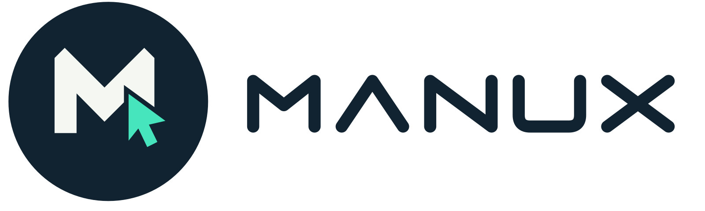

<div align="center">

  

  # 🖐️ ManuX: Next-Gen AI Vision Air Mouse

  **웹캠과 온디바이스 MediaPipe AI 비전으로 모니터 위에 투명 AR HUD를 띄워 손으로 Windows를 제어하는 차세대 핸즈프리 에어 마우스 시스템**

  <p align="center">
    
    
    
    
    
  </p>
  <p align="center">
    
    
    
    
    
  </p>

</div>

---

## ⚡ 빠른 실행 (1-Click Run)

`manux` 폴더의 **`실행.bat`**를 더블클릭하면 의존성 검사, 오프라인 인식 모델 다운로드, 앱 실행이 자동으로 처리됩니다.

```batch
실행.bat
```

> **시스템 요구사항**: Windows 10/11 (x64), Node.js (LTS), 일반 USB 웹캠 또는 노트북 내장 카메라

---

## 📂 프로젝트 폴더 구조 및 핵심 파일 안내

```
manux/
├── 📄 package.json                  # 프로젝트 메타데이터, 의존성 및 테스트 스크립트
├── 📄 server.js                    # 로컬 정적 서빙 및 개발 서버
├── 📄 실행.bat                     # 원클릭 환경 구성 및 앱 실행 스크립트
├── 📄 README.md                    # 프로젝트 안내 문서
│
├── 🧠 src/                          # [핵심] 웹캠 비전 및 에어 마우스 로직
│   ├── ⭐ air-mouse-controller.js   # 🔥 [핵심 두뇌] 21개 관절 3D 좌표를 분석하여 손 모양/제스처를 판단하는 파일
│   ├── 📄 mouse-workspace.js        # UI 상호작용, Active Zone(동작 영역) 드래그/리사이즈, 오버레이 상태 관리
│   ├── 📄 app.js                    # 웹캠 비디오 스트림 제어, 60fps 비전 루프, 캔버스 스켈레톤 렌더링
│   ├── 📄 camera.js                 # 웹캠 해상도(480p/720p/1080p) 및 디바이스 스트림 제약 조건
│   ├── 📄 vision-client.js          # MediaPipe Tasks Vision 클라이언트 인터페이스
│   └── 📄 vision-worker.js          # 백그라운드 웹 워커 (메인 UI 프레임 드랍 없는 비전 추론)
│
├── 🖥️ desktop/                      # Electron 데스크톱 셸 및 Windows 네이티브 드라이버
│   ├── 📄 main.mjs                  # Electron 메인 프로세스 (투명 프레임리스 윈도우, 마우스 이벤트 관통)
│   ├── 📄 preload.cjs               # 렌더러와 OS 간의 격리된 보안 IPC 브리지
│   ├── 📄 mouse-bridge.mjs          # Node.js ↔ PowerShell 네이티브 드라이버 IPC 생명주기 관리
│   ├── 📄 security.mjs              # 안전한 IPC 원격 호출 검증 및 토큰 유효성 검사
│   └── 📄 windows-mouse.ps1         # Windows C# P/Invoke Win32 SendInput (0x8001 절대 좌표) 네이티브 드라이버
│
├── 🌐 public/                       # 프론트엔드 UI 자산
│   ├── 📄 index.html                # 설정 대시보드 및 화면 전체 투명 AR HUD 오버레이 뷰
│   ├── 📄 styles.css                # 반응형 2열 레이아웃, 네온 AR 타겟 및 Active Zone 인터랙티브 스타일
│   ├── 📁 assets/                   # SVG 로고 및 그래픽 리소스
│   └── 📁 models/                   # MediaPipe Tasks Vision 오프라인 모델 (`gesture_recognizer.task`)
│
├── 🧪 tests/                        # 자동화 테스트 스위트 (100% 로컬 검증)
│   ├── 📄 air-mouse-controller.test.js # 손 관절 기하학, 3D 기저, 제스처 상태머신 54개 단위 테스트
│   ├── 📄 desktop-mouse.test.js     # 데스크톱 IPC 및 SendInput 드라이버 안전성 테스트
│   └── 📁 helpers/                  # 가상 3D 손 관절 합성 픽스처 (`mouse-hand.js`)
│
└── 📜 scripts/                      # 빌드/테스트 유틸리티 (`setup.mjs`, `test-desktop-mouse.mjs`)
```

---

## 🧠 관절 모양을 보고 판단하는 핵심 파일

> ### ⭐ `src/air-mouse-controller.js`
> **MediaPipe가 추출한 손의 21개 3D 관절 좌표(`landmarks`)를 실시간으로 넘겨받아 사용자의 손 모양과 제스처를 최종 판단하는 핵심 두뇌 파일입니다.**

### 주요 판단 알고리즘 및 역할:
1. **3D 손바닥 고유 정규직교기저 (Intrinsic Palm Basis, `L120-170`)**:
   - 손목(`LM 0`), 중지 너클(`LM 9`), 검지/소지 너클을 그람-슈미트(Gram-Schmidt) 직교화하여 손바닥 고유의 가로축($\vec{u}$), 세로축($\vec{v}$), 법선축($\vec{n}$)을 생성.
   - 손이 카메라 앞에서 기울어지거나 비틀어져도(Pitch/Yaw) 손바닥 기준의 고유 좌표계를 유지.
2. **검지 포인터 조준 및 고정 (Cursor Freeze, `L200-230`)**:
   - 검지 끝(`LM 8`)의 3D 궤적을 추적하며, 검지를 접는 순간(`cos3D < -0.75`) 커서 좌표를 픽셀 단위로 잠금(Freeze).
3. **엄지 펴기: 좌클릭 & 드래그 (`L235-246`)**:
   - 엄지 끝(`LM 4`)이 검지/너클로부터 충분히 이탈하고 펴졌는지(`dThumbMCP`, `thCos234`) 판정하여 좌클릭 및 유지 시 드래그 발동.
4. **소지 펴기: 우클릭 (`L247-272`)**:
   - 새끼손가락 끝(`LM 20`)이 소지 너클 대비 전진하고 신전되었는지 판정하여 우클릭 발동.
5. **손바닥(🖐) & V자(✌️) 휠 스크롤 (`L290-305`)**:
   - 손바닥을 활짝 펴거나 V자를 취하고 위아래로 움직일 때 부드러운 관성 스크롤 발동.
6. **주먹(✊) 완전 휴식 세이프티 게이트 (`L273-285`)**:
   - 4개 손가락이 모두 접히고 엄지가 접힌 주먹 상태에서는 모든 클릭 및 이동을 100% 무효화하여 오동작 원천 차단.

---

## 🚀 새로운 상호작용 패러다임 (Core Paradigm)

### 1. 모니터 투명 HUD 오버레이 (아이 트래커 방식)
* 작은 웹캠 창을 쳐다볼 필요 없이, **모니터 화면 전체에 검지(LM 8)·엄지(LM 4)·소지(LM 20)·중지(LM 12) 네온 AR 포인트가 직접 오버레이**됩니다.
* Electron의 `setIgnoreMouseEvents(true, { forward: true })` 기술로 웹서핑, 문서 편집, 게임 등 모든 Windows 프로그램 위에서 투명하게 클릭이 관통됩니다.

### 2. 가상 동작 영역 (Active Zone) 1:1 확대 투영
* 웹캠 화면 전체를 쓰면 화면 하단(작업 표시줄)으로 갈 때 손목이 카메라 밖으로 이탈합니다.
* 카메라 화면 상단에 **모니터 비율의 직사각형(Active Zone)**을 띄우고, 손이 이 작은 박스 안에서만 움직여도 Windows 모니터 전체(0~100%)에 도달할 수 있도록 정방향 확대 매핑을 제공합니다.
* 사용자가 프리뷰 화면에서 마우스로 네모 박스를 직접 잡고 드래그하거나 모서리를 끌어 크기를 리사이즈할 수 있습니다.

### 3. 신형 트리거 모드 (Trigger Paradigm)
* **포인터 이동 (검지)**: 검지 끝(`LM 8`)을 직접 추적하며, 검지를 접으면 그 자리에 커서가 고정(Freeze)됩니다.
* **좌클릭 & 드래그 (엄지)**: 검지로 조준한 상태에서 엄지만 펴면 즉시 좌클릭되며, 유지하면 드래그가 됩니다. 검지를 접고 엄지를 펴면 흔들림 0% 정밀 클릭이 가능합니다.
* **우클릭 (소지)**: 새끼손가락만 펴면 우클릭이 발동되며, 엄지와 소지를 동시에 펴면 좌우 동시 클릭이 지원됩니다.
* **휠 스크롤 (손바닥/V자)**: 손바닥(🖐) 또는 V자(✌️)를 펴고 손을 위아래로 그으면 부드럽게 휠 스크롤됩니다.
* **휴식 (주먹)**: 주먹을 쥐면 모든 추적과 입력이 정지되는 안전 휴식 상태가 됩니다.

---

## 🎮 제스처 조작 표 (Gesture Cheatsheet)

| 제스처 | HUD 시각 피드백 | 기능 | 상세 동작 및 생체역학 |
| :---: | :---: | :---: | :--- |
| **👆 검지 조준** | 청록색(Cyan) 조준링 & 십자선 | **커서 이동 (접으면 고정)** | 검지 끝(LM 8) 직접 추적, 접으면 커서 위치 고정(Lock) |
| **👍 엄지 펴기** | 호박색(Amber) 레이저 링 | **좌클릭 & 연속 드래그** | 엄지 펴면 즉시 좌클릭, 유지 시 드래그 (조준 흔들림 0%) |
| **🤙 소지 펴기** | 인디고(Indigo) 레이저 링 | **우클릭** | 새끼손가락만 펴면 우클릭 (엄지+소지 동시 펴기 지원) |
| **🖐️ 손바닥 / ✌️ V자** | 보라색(Purple) 나침반 가이드 | **휠 스크롤** | 손바닥 또는 V자 펴고 위/아래 이동 시 휠 스크롤 |
| **✊ 주먹 (Fist)** | 오버레이 소멸 (Idle) | **완전 휴식 (Safety Gate)** | 주먹을 쥐면 모든 클릭/이동 100% 무효화 |

---

## ⌨️ 단축키 안내 (Keyboard Shortcuts & Hotkeys)

| 단축키 | 적용 범위 | 설명 |
| :--- | :--- | :--- |
| **`F11`** | 앱 창 및 오버레이 | **화면 투명 HUD 오버레이 모드 토글** (모니터 전체 화면 AR 모드) |
| **`Esc`** | 앱 및 오버레이 | **일반 창 모드로 복귀** / 마우스 제어 일시 중지 |
| **`Ctrl + Alt + M`** | **Windows 전체 (글로벌)** | **비상 제어 중지 (Emergency Stop)** (어떤 프로그램 실행 중에도 즉시 마우스 권한 해제) |

---

## 🧪 테스트 및 품질 검증

```powershell
# 단위 테스트 (AirMouseController 54개 테스트 통과)
npm test

# Windows 네이티브 SendInput 드라이버 안전성 검증 (dry-run 모드)
npm run test:native
```

---

## 🔒 개인정보 및 보안 원칙

* **100% 로컬 오프라인 처리**: 웹캠 영상과 손 관절 좌표는 외부 서버로 전송되지 않으며 사용자 PC 메모리 내에서만 실시간 처리 후 소멸됩니다.
* **비상 정지 보장**: `Ctrl + Alt + M` 글로벌 단축키는 언제든 즉시 시스템 제어권을 회수하며, 앱 비정상 종료 시 네이티브 드라이버가 누른 상태의 모든 마우스 버튼을 즉각 릴리즈합니다.
